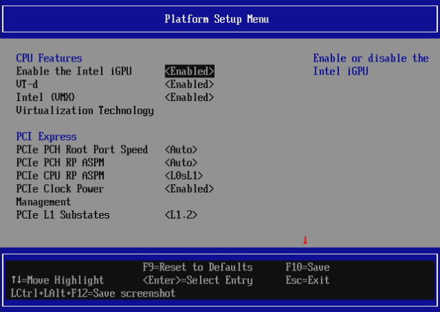
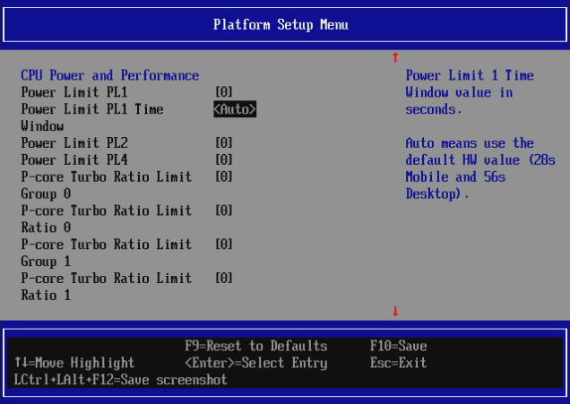
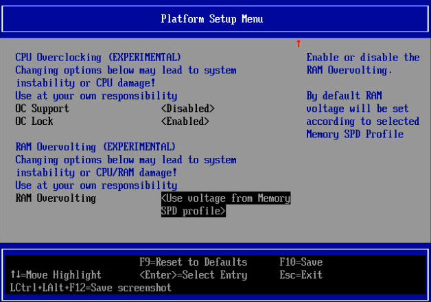
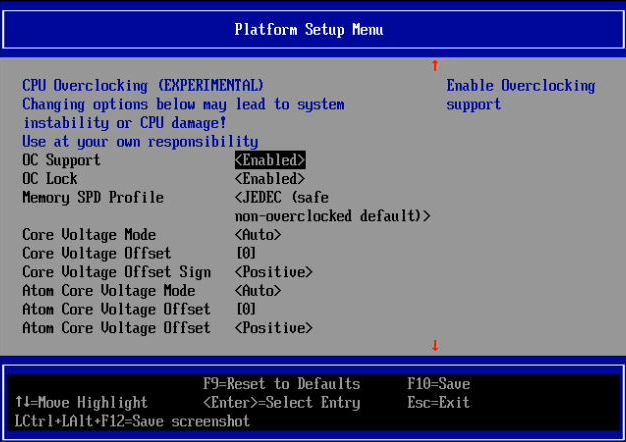
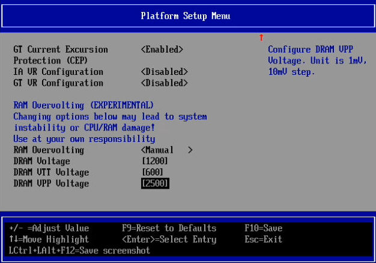
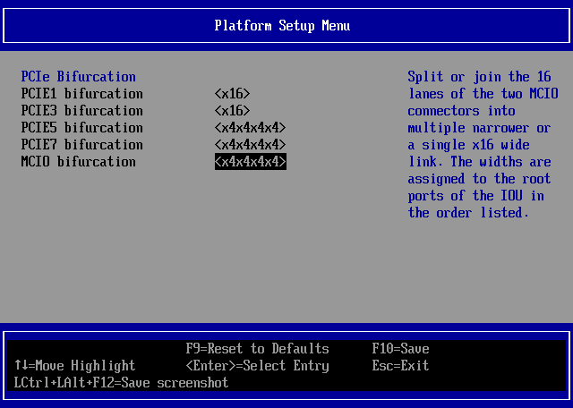
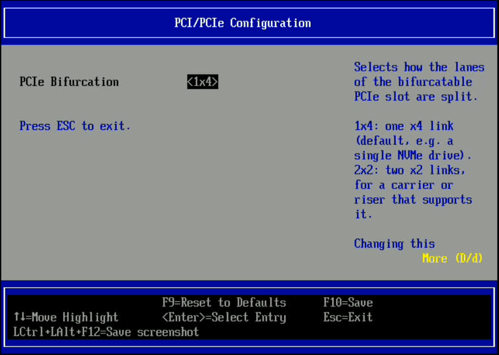

# Platform Setup Menu

This menu contains platform-specific options. The contents of the menu depends
on platform and may vary across boards and firmware versions.

Example view of the menu options:

{ class="center" }

{ class="center" }

{ class="center" }

The available settings vary by platform. Each section below lists the
platforms on which the given options are available.

## Overclocking menu

**Available on:** MSI PRO Z690-A, MSI PRO Z790-P

Overclocking options may appear only on overclocking capable platforms such as
Intel-based MSI PRO Z690-A/Z790-P boards. Enabling the overclocking causes
more options to appear.

!!! Danger

    **These options are EXPERIMENTAL!** Be sure to have a recovery method before
    changing any of these options. They may cause system instability or
    hardware damage. Use them at your own responsibility. Warranty claims due
    to damage caused by changing these options will not be accepted and support
    is not provided.

{ class="center" }

Feel free to contribute documentation and tips how to modify these options or
to explain their meaning based on your experiments.

## RAM overvolting menu

**Available on:** MSI PRO Z690-A DDR4, MSI PRO Z790-P DDR4

RAM overvolting options are specific to DDR4 variants of Intel-based MSI PRO
Z690-A/Z790-P boards. Changing the RAM overvolting option to manual causes
more options to appear.

!!! Danger

    **These options are EXPERIMENTAL!** Be sure to have a recovery method before
    changing any of these options. They may cause system instability or
    hardware damage. Use them at your own responsibility. Warranty claims due
    to damage caused by changing these options will not be accepted and support
    is not provided.

{ class="center" }

Feel free to contribute documentation and tips how to modify these options or
to explain their meaning based on your experiments.

## PCIe Bifurcation

**Available on:** ASRock SPC741D8, Protectli V2210

!!! info
    On Protectli V2210, setting the bifurcation requires modifying the PCIe
    link assignment bits in the Intel Flash Descriptor at runtime. Due to this
    the Flash Descriptor cannot be locked, so fwupd HSI level HSI-1 is unachievable.

    Boot Guard provisioning also locks down the Flash Descriptor by default,
    therefore the option is not compatible with potential enablement of
    Intel Boot Guard in its current form.

These settings enable bifurcation (splitting) of physical PCIe links into
several narrower links. For example, a physical x16 slot may be bifurcated into
four x4 links, allowing the use of 4 PCIe devices in a single slot (an
appropriate riser module is required).

{ class="center" }

Available values (ASRock SPC741D8):

* x16
* x8x8
* x4x4x8
* x8x4x4
* x4x4x4x4

Available values (Protectli V2210):

* 1x4 (1 link of width x4)
* 2x2 (2 links of width x2)
* 4x1 (4 links of width x1)

These settings require a reboot to take effect.

!!! note
    On Protectli V2210 these settings are currently available at
    `Dasharo System Settings` -> `PCI/PCIe Configuration`

    { class="center" }
